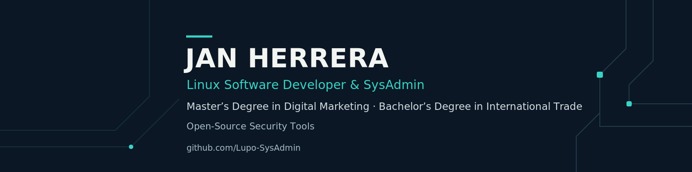

[LinkedIn](https://www.linkedin.com/in/janherreraa/) · [Repositorios](https://github.com/Lupo-SysAdmin?tab=repositories)

**Formación:** Maestría en Marketing Digital · Licenciatura en Comercio Internacional.

Desarrollo aplicaciones de escritorio e integraciones para herramientas de seguridad en Linux, con Python, Qt/QML, systemd y empaquetado Debian.

| Proyecto | Mi contribución |
| --- | --- |
| [JALTRIX](https://github.com/Lupo-SysAdmin/JALTRIX) | Consola Linux de investigación para Snort 3. |
| [USBGuard Control](https://github.com/Lupo-SysAdmin/usbguard-control) | Interfaz de escritorio independiente para USBGuard. |
| [Autopsy GUI Linux](https://github.com/Lupo-SysAdmin/Autopsy-GUI-Linux) | Integración Linux, empaquetado Debian y validación. |

**Lupo Studio:** en desarrollo.

La interfaz original de Autopsy, Snort, USBGuard y los demás componentes conservan su autoría y licencias. El alcance de validación y las instrucciones de instalación se documentan en cada repositorio.

### Apoya mi trabajo

Si mis herramientas te resultan útiles, puedes apoyar el tiempo que dedico al desarrollo, las pruebas, el empaquetado y la documentación. Cualquier aporte es bienvenido y voluntario. ¡Gracias!

**Aportes únicos (USD)**

**Apoyo mensual**

Elige el monto y marca la opción de **donación mensual** en PayPal para activar el apoyo mensual automático.

También puedes ayudar reportando errores, compartiendo los proyectos o contribuyendo a la documentación.

<!-- Personal visual identity source: assets/*.svg. PNG exports are used for consistent rendering. -->
