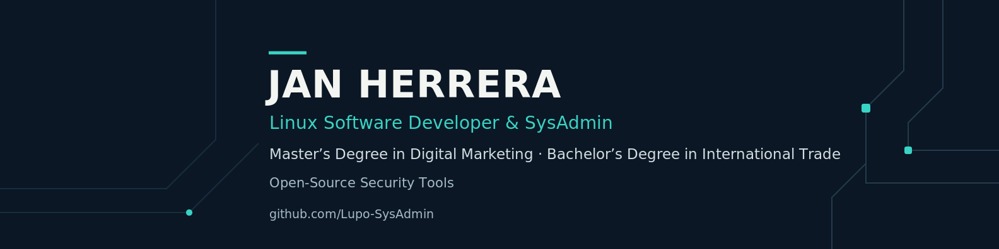

[LinkedIn](https://www.linkedin.com/in/janherreraa/) · [Repositories](https://github.com/Lupo-SysAdmin?tab=repositories)

I develop Linux desktop applications and integrations for security tools, with Python, Qt/QML, systemd, and Debian packaging.

Desarrollo aplicaciones de escritorio e integraciones para herramientas de seguridad en Linux, con Python, Qt/QML, systemd y empaquetado Debian.

| Project / Proyecto | My contribution / Mi contribución |
| --- | --- |
| [JALTRIX](https://github.com/Lupo-SysAdmin/JALTRIX) | Linux investigation console for Snort 3. / Consola Linux de investigación para Snort 3. |
| [USBGuard Control](https://github.com/Lupo-SysAdmin/usbguard-control) | Independent desktop interface for USBGuard. / Interfaz de escritorio independiente para USBGuard. |
| [Autopsy GUI Linux](https://github.com/Lupo-SysAdmin/Autopsy-GUI-Linux) | Linux integration, Debian packaging and validation. / Integración Linux, empaquetado Debian y validación. |

**Lupo Studio:** in development / en desarrollo.

Original Autopsy GUI, Snort, USBGuard, and other upstream components retain their own authorship and licenses. Validation scope and installation details are documented in each repository.

La interfaz original de Autopsy, Snort, USBGuard y los demás componentes conservan su autoría y licencias. El alcance de validación y las instrucciones de instalación se documentan en cada repositorio.

### Support my work / Apoya mi trabajo

If my tools are useful to you, you can support the time I spend on development, testing, packaging, and documentation. Every contribution is welcome and voluntary. Thank you!

Si mis herramientas te resultan útiles, puedes apoyar el tiempo que dedico al desarrollo, las pruebas, el empaquetado y la documentación. Cualquier aporte es bienvenido y voluntario. ¡Gracias!

**One-time contributions (USD) / Aportes únicos (USD)**

**Monthly support / Apoyo mensual**

Choose your amount and select **“Make this a monthly donation”** on PayPal to enable automatic monthly support.

Elige el monto y marca la opción de **donación mensual** en PayPal para activar el apoyo mensual automático.

You can also help by reporting bugs, sharing the projects, or contributing to documentation.

También puedes ayudar reportando errores, compartiendo los proyectos o contribuyendo a la documentación.

<!-- Personal visual identity source: assets/*.svg. PNG exports are used for consistent rendering. -->
